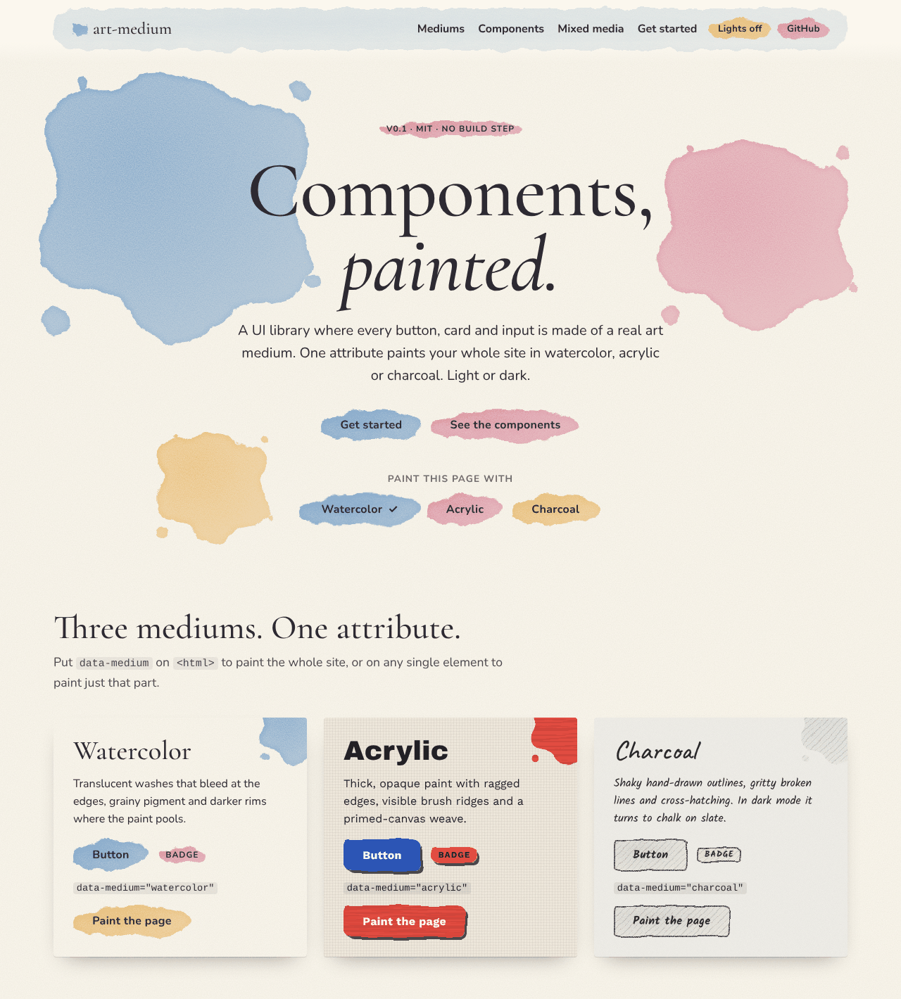

# art-medium

A UI component library where the components are made of art. Buttons, cards, inputs and nav bars are painted in a real medium instead of being flat rectangles.

| Medium | Looks like |
| --- | --- |
| `watercolor` | Translucent washes, bleeding edges, pigment granulation, darker pooled rims, cold-press paper |
| `acrylic` | Opaque, saturated paint, ragged edges, lit brush-stroke ridges, primed canvas weave |
| `charcoal` | Wobbly hand-drawn outlines, gritty broken lines, cross-hatching, newsprint (chalk on slate in dark mode) |



Components: **button, badge, card, input, divider, nav, modal, splash**, plus **canvas** (the page background). Every medium has a light and a dark theme.

## Try the demo

**Live:** https://ghanemja.github.io/art-asset/

Or run it locally:

```sh
npm run demo   # then open http://localhost:8080/
```

## Install

From the CDN (pinned to a release):

```html
<link rel="stylesheet" href="https://cdn.jsdelivr.net/gh/ghanemja/art-asset@v0.1.0/src/art-medium.css">
<script type="module" src="https://cdn.jsdelivr.net/gh/ghanemja/art-asset@v0.1.0/src/art-medium.js"></script>
```

Or from GitHub with npm:

```sh
npm i github:ghanemja/art-asset#v0.1.0
```

```js
import 'art-medium/css';
import { setMedium, setTheme } from 'art-medium';
```

## Use it

Plain HTML, no framework or build step:

```html
<body class="am-canvas" data-medium="watercolor" data-theme="auto">
  <button class="am-button">Primary</button>
  <button class="am-button am--secondary">Secondary</button>
  <span class="am-badge am--accent">New</span>

  <article class="am-card">
    <h3 class="am-card__title">Still life</h3>
    <p>Painted behind, crisp text in front.</p>
  </article>

  <label class="am-field">
    <span class="am-field__label">Name</span>
    <span class="am-input"><input placeholder="…"></span>
  </label>

  <hr class="am-divider">
</body>
```

The JS module is required. It injects the SVG filters that the CSS refers to (`filter: url(#am-watercolor)`).

### Picking a medium

`data-medium` applies to the element it's on and everything inside it. Set it on `<html>` to theme the page, or on one component to override it:

```html
<html data-medium="charcoal">
  …
  <button class="am-button" data-medium="acrylic">This one is acrylic</button>
```

To switch at runtime:

```js
import { setMedium } from 'art-medium';
setMedium(document.documentElement, 'acrylic');
```

### Light and dark

`data-theme="light" | "dark" | "auto"` works the same way: put it on `<html>` or on any section. `auto` follows the visitor's system setting. With no `data-theme`, everything is light, so adding the library never darkens a site that wasn't designed for it.

```js
import { setTheme } from 'art-medium';
setTheme(document.documentElement, 'dark');
```

In dark mode watercolor sits on indigo paper, acrylic on black gesso, and charcoal becomes chalk on a slate board.

### Splash

`.am-splash` is a decorative paint splat for hero sections, logos and empty states. It is sized by its width and works at any size:

```html
<span class="am-splash am--secondary" style="width: 20rem" aria-hidden="true"></span>
```

### Variants

`am--secondary` and `am--accent` switch to the medium's second and third pigments. They work on buttons, badges, dividers and splashes.

### React

```jsx
import 'art-medium/css';
import { MediumProvider, Button, Card, Input, Badge, Divider, Nav, Modal, Splash } from 'art-medium/react';

<MediumProvider medium="watercolor" theme="auto">
  <Nav brand="Studio" links={[{ href: '/', label: 'Work', current: true }]} />
  <Card title="Still life">
    <Input label="Email" type="email" />
    <Button variant="secondary" medium="acrylic">Subscribe</Button>
  </Card>
</MediumProvider>
```

## How it works

- **Painted layer.** Each component draws its paint on a `::before` pseudo-element behind its content. That layer goes through an SVG filter, so the paint distorts but the text stays sharp.
- **Filters** (`src/art-medium.js`):
  - Watercolor uses `feTurbulence` and `feDisplacementMap` for the bleed, a noise alpha mask for granulation, and an erode-and-subtract rim for pooled edges.
  - Acrylic adds `feDiffuseLighting` over stretched noise to get brush ridges.
  - Charcoal combines a light wobble with a high-frequency grit mask.
- **Tokens.** Each medium is just CSS custom properties: pigments, fill strength, shapes, stroke, texture, filter and fonts. Components only read tokens, which is why one `data-medium` attribute can restyle anything.
- **Dark mode.** Color tokens are `light-dark(light, dark)` pairs, and `data-theme` sets `color-scheme`, so one attribute flips every color in a subtree.

### Adding a medium

Define a new `[data-medium="gouache"] { --am-… }` token block (use `light-dark()` for colors), add a matching `<filter id="am-gouache">` in `art-medium.js`, and add the name to `MEDIUMS`.

## Browser support

Current Chrome, Edge, Safari and Firefox (2024 or later). The library relies on `color-mix()`, `light-dark()` and SVG filters on HTML elements. It has been tested most in Chromium.

## Fonts

Each medium suggests display and body fonts (`--am-font-display` and `--am-font-body`), with system fallbacks. The demo loads them from Google Fonts: Cormorant Garamond and Nunito for watercolor, Archivo Black and Work Sans for acrylic, Caveat and Kalam for charcoal.

## Changelog

See [CHANGELOG.md](CHANGELOG.md).

## License

MIT. See [LICENSE](LICENSE).
